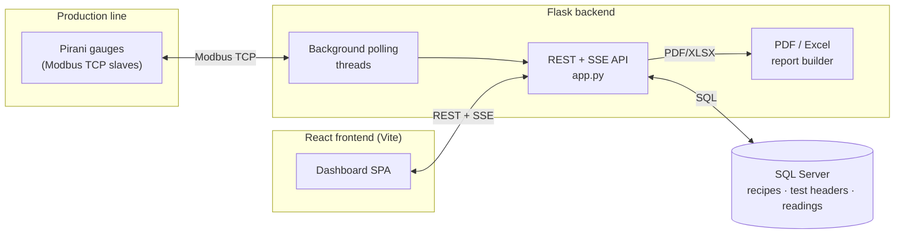

# Pirani Gauge Dashboard

A real-time production-floor dashboard for testing and monitoring **Pirani vacuum gauges** on a manufacturing line — built to replace a manual, paper-based QC process with a live Modbus-driven web app.

Operators start a test on a fixture, the backend polls the gauge over Modbus TCP at a configurable interval, results are logged to SQL Server, and engineers can pull pass/fail reports — complete with every individual reading and a one-click PDF export — without ever touching the floor PC.

---

## ✨ Features

**Live floor view**
- Real-time fixture/conveyor visualization over Server-Sent Events (SSE), with automatic fallback to polling if the stream drops
- Per-line gauge layout (configurable gauge count per production line)
- Start / stop a test on any gauge directly from the UI
- Live vacuum reading chart per fixture, today's pass/fail counters, and a rolling table of the last completed tests

**Reporting**
- Filterable report search (date range, model, line, gauge, result)
- Inline accordion per row — expand any test to see its full trend chart *and* every single poll-interval reading logged during that run, no separate page load
- One-click **Excel export** of the filtered result set
- One-click **PDF export** per test — header info, min/max/avg stats, and the complete readings log, generated server-side
- Live Modbus diagnostics endpoint for troubleshooting gateway connectivity

**One app, many production lines**
- Four lines are configured today — Freezer (54 gauges, 11 USRs), Chocolate (18, 3), Visi Cooler (30, 6), SUS (15, 3): 117 gauges on 23 USR devices. Each is defined in `.env` (gauge count, USRs, subnet, login, limits); adding or changing a line needs no code change
- Each line has its own login and sees only its own gauges, tests and reports. Extra logins can be authorised for several lines (they pick one after signing in and can switch from the header). The backend checks the line on **every** request
- Gauge number == Modbus slave ID within each line, so every line has its own "gauge 1". A gauge is identified by line + slave ID, never by slave ID alone; a USR by a stable id such as `freezer-usr-03`

**Reliable, observable polling**
- One managed polling worker per USR, owned by the backend (logins, refreshes and extra tabs never create or stop one). One failed or slow USR never delays another
- Reconnects with exponential back-off, optional bounded read retries, and a single-owner lease so two instances on one PC cannot poll the same bus
- Device and gauge health are separate: connection (connected/disconnected), polling (running/delayed/stopped/error), communication (success/timeout/connection_error/invalid_response/modbus_exception/decode_error) and freshness (live/stale/no data). A stale or failed reading is never shown as a current value
- `line_specific` mode (one PC per line, each polling only its own subnet) or `centralized`
- Startup validation of the whole topology: subnets, reserved `.0`/`.255` addresses, duplicate IPs, overlapping networks, slave/gauge coverage

---

## 🏗️ Architecture



In production, the React build is served as static files by the same Flask process — one process, one port, no extra web server required (see [`client/README.md`](client/README.md)).

---

## 🧰 Tech stack

| Layer | Technology |
|---|---|
| Frontend | React 19, Vite, Redux Toolkit, Tailwind CSS v4, Recharts, react-icons |
| Backend | Python, Flask, threading-based Modbus poller |
| Industrial protocol | Modbus TCP (`pymodbus`) |
| Database | Microsoft SQL Server (`pyodbc`) |
| Reporting | `pandas` (Excel export), `reportlab` (PDF generation) |
| Testing | `pytest` |
| Linting | `oxlint` |

---

## 📁 Project structure

```
WRL-Pirani-Gauge-Dashboard/
├── app.py                  # Flask API: login/sessions, tests, fixtures/SSE, status, reports, PDF/Excel export
├── lines_config.py          # Reads + validates lines, USRs, network, users, polling settings from .env
│                            #   (`python lines_config.py` checks .env without starting the app)
├── polling.py               # Managed Modbus polling: one worker per USR, status tracking, lease
├── register_maps.py         # Gauge register map + classification of every Modbus read outcome
├── db.py                    # SQL Server connection + queries (env-driven)
├── test_runner.py           # Test lifecycle: start/stop/poll a gauge, write readings
├── modbus_test.py           # Standalone CLI tool to scan/diagnose Modbus registers
├── requirements.txt
├── .env.example              # Copy to .env: DB, session key and all production lines
├── docs/DEPLOYMENT.md       # Network plan, per-PC setup, rollout, rollback, hardware test checklist
├── docs/TEST_RESULTS.md     # What was tested, and what has NOT been tested yet
├── migrations/              # Optional SQL scripts (verify history, index, relabel) + notes
├── tests/                   # pytest: API, config validation, polling service, register maps, test runner
└── client/                  # React frontend (Vite)
    ├── src/
    │   ├── api/client.js     # Thin fetch wrapper around the Flask API
    │   ├── pages/            # FixturesPage, SettingsPage (read-only), ReportsPage, LoginPage, SelectLinePage
    │   ├── components/       # ConveyorTrack, ReportTable, ReportAccordion, StatusBadge, GaugeDeviceStatus, ...
    │   └── store/            # Redux auth + line-config slices
    └── README.md             # Frontend-specific docs (dev/build/production serving)
```

---

## 🚀 Getting started

### Prerequisites
- Python 3.10+
- Node.js 18+
- SQL Server reachable from the backend host
- A Modbus TCP gateway/gauge reachable from the backend host (or run with `DISABLE_WORKERS=1` to develop without hardware)

### Backend

```bash
pip install -r requirements.txt
cp .env.example .env        # fill in the DB, SECRET_KEY and your production lines
python app.py                # serves the API on http://localhost:5000
```

### Frontend

```bash
cd client
npm install
npm run dev                  # http://localhost:5173, proxies /api to localhost:5000
```

### Running tests

```bash
DISABLE_WORKERS=1 pytest tests/
```

### Production build

```bash
cd client && npm run build   # outputs client/dist
cd .. && python app.py        # now also serves the React build on the same port
```

---

## 🔌 API reference

Everything except `/api/health` and `/api/auth/login` requires a login, and is automatically limited to the line the session is working on. Endpoints that need a line return `409 line_not_selected` until a multi-line user has chosen one.

| Method | Route | Description |
|---|---|---|
| POST | `/api/auth/login` | `{username, password}` → logs in; a single-line user gets the line selected |
| POST | `/api/auth/logout` | End this browser session (polling is unaffected) |
| GET | `/api/auth/me` | Current user, authorised lines, selected line |
| POST | `/api/auth/select-line` | `{line}` → choose / switch line (must be one the user is authorised for) |
| GET | `/api/health` | Health check; when logged in, also USR/worker summary for the line |
| GET | `/api/stats/today` | Today's pass/fail counters for the line |
| POST | `/start-test` | Start a test on a gauge of the line |
| POST | `/stop-test/<gauge_id>` | Stop a running test |
| GET | `/api/active-tests` | Running tests on the line |
| GET | `/api/fixtures` | Snapshot of the line's fixture states |
| GET | `/api/fixtures/stream` | SSE stream of the line's live fixture state |
| GET | `/api/fixture-live/<slave_id>` | Live gauge status: value, freshness, USR id/IP, connection/polling/communication status, last success, last error |
| GET | `/api/fixture/<slave_id>` | Gauge detail |
| GET | `/api/modbus/diagnostics` | Per-USR worker health and per-gauge status for the line |
| GET | `/api/settings/lines` | The line's configuration incl. network (read-only, from `.env`) |
| POST | `/api/settings/test-connection` | **Admin only.** Probe one of the line's own USRs |
| GET | `/api/reports` | Filterable report search (`?export=excel` for Excel) |
| GET | `/api/report/<test_id>/trend` | Every poll reading for one test |
| GET | `/api/report/<test_id>/pdf` | Download a PDF report for one test |

---

## 🔐 Configuration (`.env`)

All configuration is in `.env` (see `.env.example`). **After editing it, restart the app.** If something is wrong the app refuses to start and prints every problem it found.

**General**

| Variable | Purpose |
|---|---|
| `DB_SERVER`, `DB_NAME`, `DB_USER`, `DB_PASSWORD` | SQL Server connection |
| `SECRET_KEY` | Signs login cookies. Keep it secret and stable between restarts |
| `SESSION_HOURS` | How long a login lasts (default 12) |
| `DISABLE_WORKERS` | `1` skips the background polling threads (dev/tests without hardware) |
| `LINES` | Comma-separated line keys, e.g. `FREEZER,CHOCOLATE,VISI_COOLER,SUS` |

**Polling** (which gauges *this PC* talks to)

| Variable | Default | Meaning |
|---|---|---|
| `POLLING_MODE` | `line_specific` | `line_specific`: poll only `POLL_LINES`. `centralized`: poll several lines — only with a verified route to each |
| `POLL_LINES` | required in `line_specific` | Line(s) wired to this PC, e.g. `CHOCOLATE` (`ALL` allowed) |
| `MODBUS_TIMEOUT_SEC` | 5 | Per-request timeout |
| `MODBUS_READ_RETRIES` | 0 | Extra immediate attempts after a failed read |
| `MODBUS_BACKOFF_INITIAL_SEC` / `_MAX_SEC` | 5 / 60 | Reconnect delay to an unreachable USR; doubles up to the maximum |
| `POLL_CYCLE_PAUSE_SEC` | 2 | Pause between passes over a USR's gauges |
| `STALE_AFTER_SEC` | 30 | A reading older than this is shown as stale |
| `POLL_LEASE_PORT` | 47653 | Local port ensuring one polling instance per PC |

**Per line** — repeat for each key in `LINES`, as `LINE_<KEY>_<SETTING>`:

| Setting | Required | Meaning |
|---|---|---|
| `USERNAME`, `PASSWORD` | yes | This line's login (must differ between lines) |
| `GAUGES` | yes | Number of gauges. Gauge number == slave ID, `1..N` within the line |
| `GATEWAYS` | yes | The line's USR devices: `host:port:first-last, ...`. USR ids (`freezer-usr-01`, …) follow this order — keep it stable |
| `UPPER_LIMIT` | yes | Pass/fail ceiling in mbar (`0` = not set: every test FAILs) |
| `LABEL` | no | Display name (default: the key, tidied) |
| `DISABLED_USRS` | no | USRs out of service, by number or id, e.g. `3` or `freezer-usr-03` |
| `DISABLED_GAUGES` | no | Gauges out of service, e.g. `5,7,10-12` |
| `POLL_INTERVAL_SEC` | no | Seconds between readings during a test (60–3600, default 60) |
| `READING_DELAY_SEC` | no | Settle time before readings count (0–3600, default 0) |
| `MIN_DURATION_SEC` | no | IN/OUT auto-stop can't end a test sooner (0–3600, default 600) |
| `GAP` | no | IN/OUT auto-stop distance, `0` = off (default 0) |
| `REGISTER_MAP` | no | Gauge register map (default `pirani_default`) |
| `SUBNET`, `PC_IP`, `ROUTER_IP`, `COMPANY_PC_IP` | no | Network documentation, validated at startup: addresses must lie in the subnet, not be the `.0`/`.255` address, and not clash |

**Extra logins** — `USERS=ADMIN`, then `USER_ADMIN_USERNAME`, `USER_ADMIN_PASSWORD`, `USER_ADMIN_LINES` (line keys or `ALL`), `USER_ADMIN_ROLE` (`operator` | `admin`). Only admins can use the Settings page's Test connection button.

Example — Chocolate: 18 gauges behind 3 USR devices:

```
LINES=CHOCOLATE
POLL_LINES=CHOCOLATE
LINE_CHOCOLATE_USERNAME=chocolate
LINE_CHOCOLATE_PASSWORD=change-me
LINE_CHOCOLATE_GAUGES=18
LINE_CHOCOLATE_GATEWAYS=192.168.2.3:502:1-6,192.168.2.4:502:7-12,192.168.2.5:502:13-18
LINE_CHOCOLATE_UPPER_LIMIT=0.5
LINE_CHOCOLATE_SUBNET=192.168.2.0/24
LINE_CHOCOLATE_PC_IP=192.168.2.1
LINE_CHOCOLATE_ROUTER_IP=192.168.2.2
```

Every gauge `1..N` must sit behind exactly one USR, and two lines can't share one. If a router forwards a different port to each USR, use the same host with different ports. The line key is stored as `line_name` on every test, so keep keys stable once tests exist.

Network setup, per-PC settings, rollout, rollback and the hardware checklist are in **[docs/DEPLOYMENT.md](docs/DEPLOYMENT.md)**.

---

## 🗺️ Possible next steps

- Code-split the frontend bundle (currently a single ~675 KB chunk)
- Hash the line passwords instead of keeping them in plain text in `.env`
- Continuous per-gauge history (needs a retention decision first; see `migrations/README.md`)
- WebSocket upgrade for the live fixture stream

---

## 📄 License

This project is provided as-is for internal/educational use. Add a license of your choice before distributing publicly.
